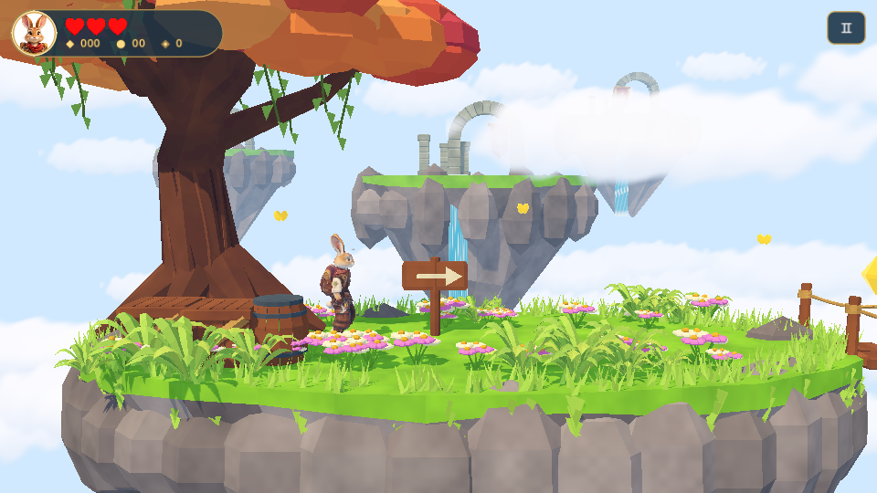
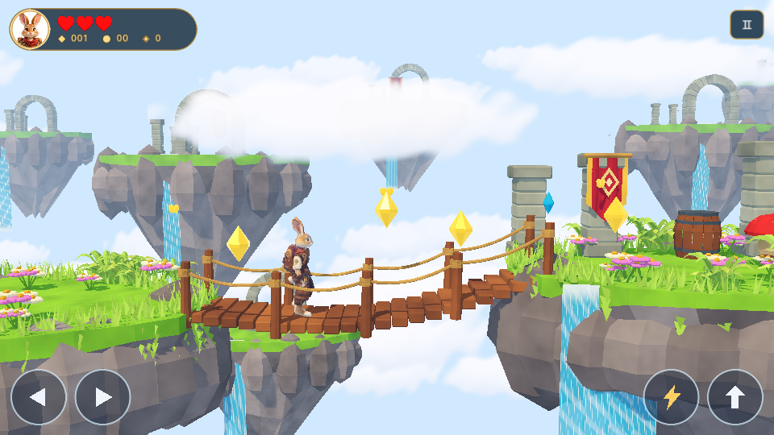
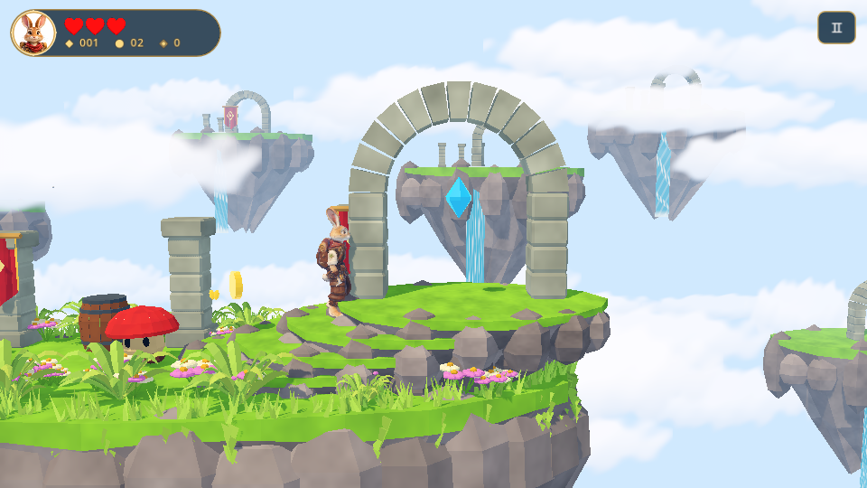

# Jardins Celestiais

A imagem oficial organiza o caminho entre uma árvore vermelha que emoldura a partida e um arco de pedra elevado que enquadra o objetivo. A ponte estreita deixa o céu visível por baixo dos pés. Os tons quentes das tábuas e dos cristais dourados destacam o percurso sobre as quedas azuis. Ilhas menores, cachoeiras e ruínas em profundidade sugerem outras áreas exploráveis.

A implementação distribui essa composição por três enquadramentos jogáveis. A perspectiva lateral com FOV de 39° produz paralaxe real. O detalhe de rochas, folhagem e madeira combina geometria irregular, cor por vértice e variação procedural de superfície. A vegetação dos módulos recebe deslocamento de vento. A água usa faixas animadas, espuma nas extremidades e partículas junto à queda principal. As nuvens usam planos com borda translúcida e movimento de contorno.

| Área inicial | Ponte | Arco |
|---|---|---|
|  |  |  |

As capturas são da execução no Godot. A copa, as rochas e o acabamento das ruínas ainda apresentam facetas visíveis. A ilustração oficial tem folhagem mais densa, rocha esculpida e texturas pintadas mais detalhadas.
